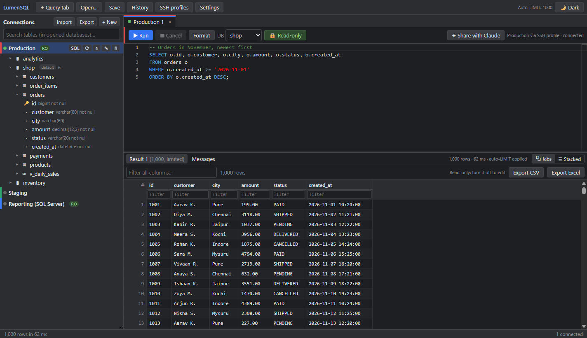
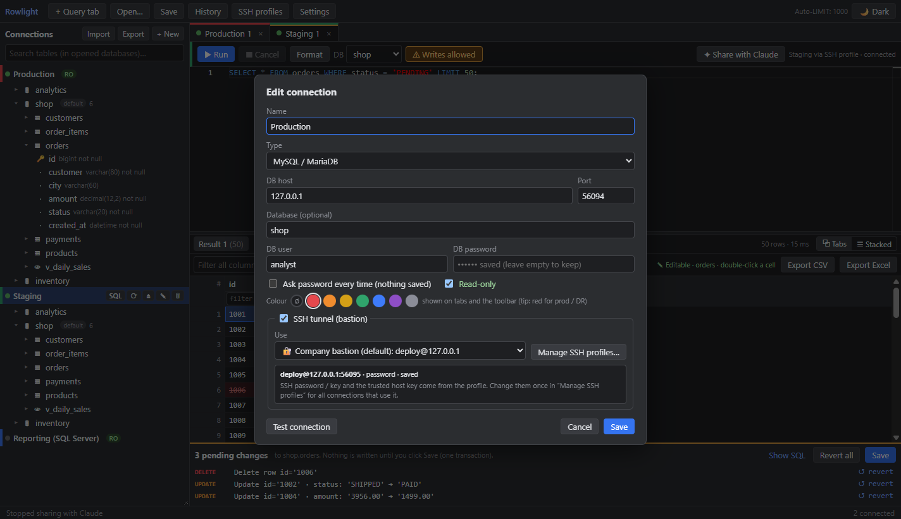
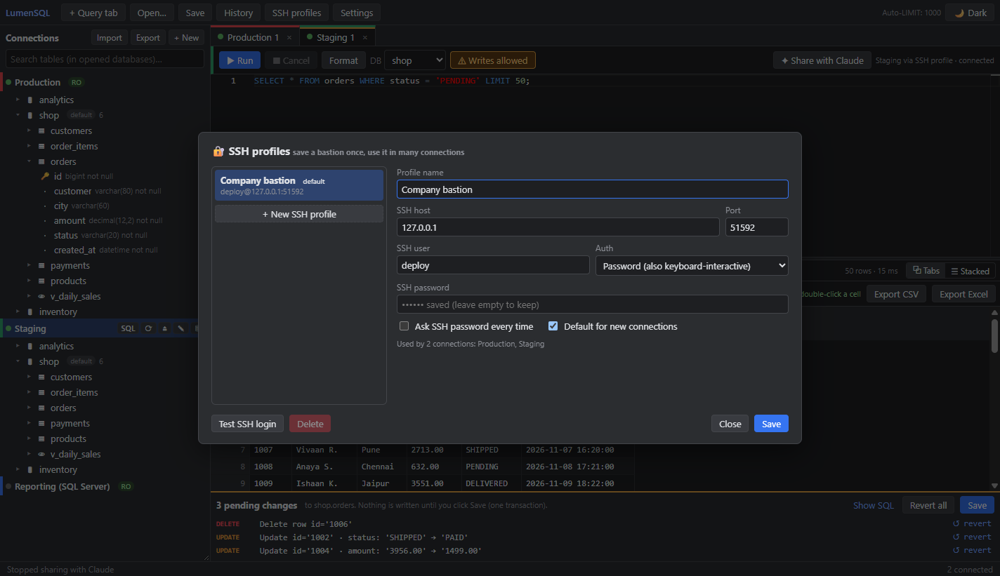
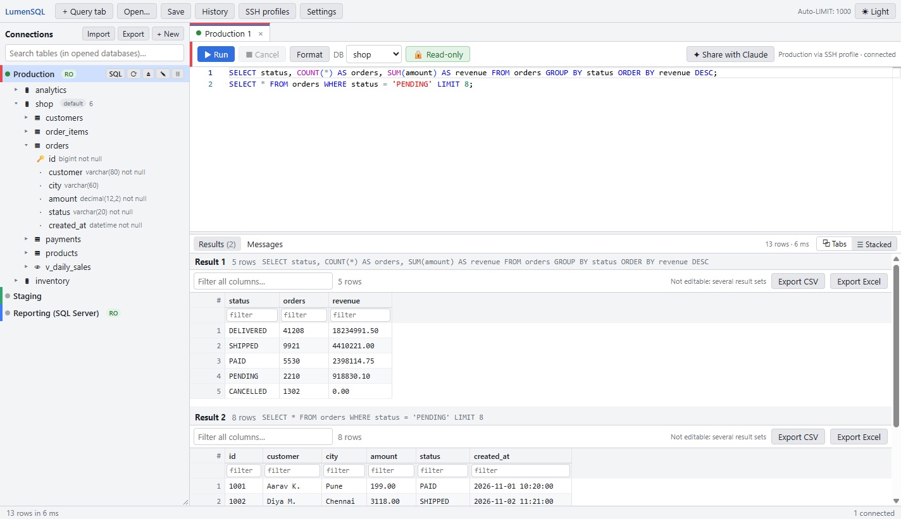
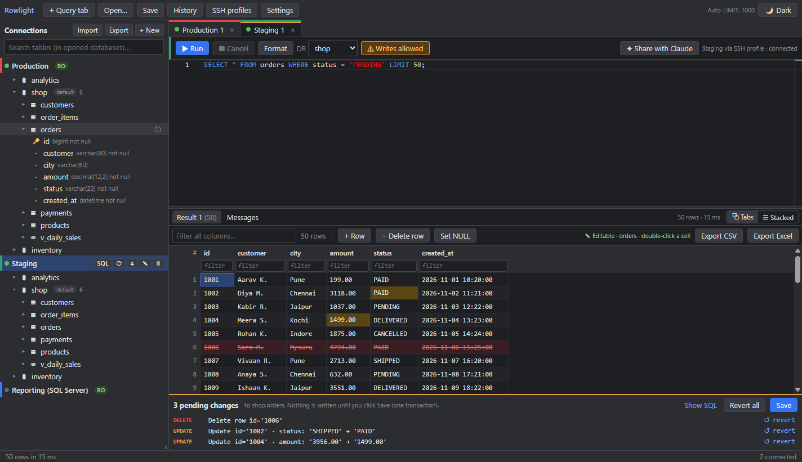
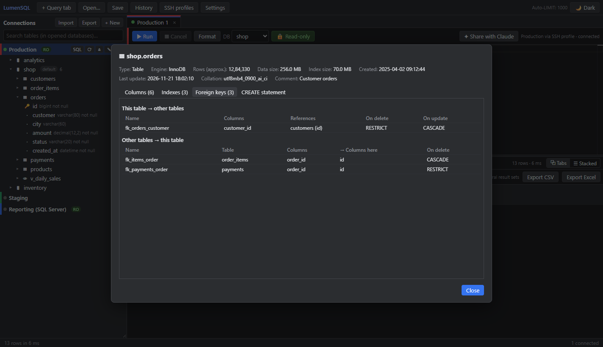
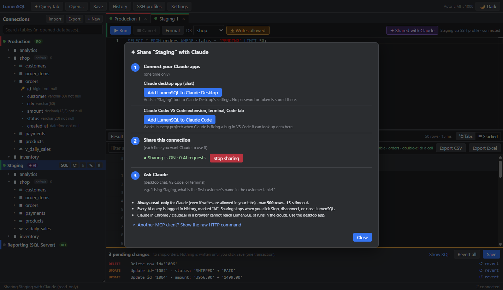

# Rowlight

**Shine a light on your rows.** A fast, safety-first SQL client for Windows with built-in SSH tunnelling and
Claude AI integration. Works with **MySQL / MariaDB** and **Microsoft SQL Server**.

Rowlight is made for people who query production databases that sit behind an SSH bastion. You get the everyday
features of a desktop SQL client, plus guard rails so a stray `DELETE` never reaches prod. You can also let Claude
(desktop app, VS Code or terminal) look up data for you without ever giving it write access.

> Formerly published as *LumenSQL*. The name was changed to avoid confusion with other projects; installing Rowlight
> moves your existing connections, SSH profiles, history and Claude links over automatically.



---

## Why Rowlight?

- **The SSH tunnel just works.** SSH is built in (the pure-JavaScript [`ssh2`](https://github.com/mscdex/ssh2) library),
  so there's no `ssh.exe`, no PuTTY, no `SSH_ASKPASS`. It handles password and keyboard-interactive login (including
  one-time codes), private keys, keep-alive, and checks the host key.
- **Safe by default.** Connections whose name contains `prod` or `dr` start **read-only**. Writes and DDL are blocked
  *before anything runs*, and on MySQL the session itself is also read-only. SELECTs without a limit get an
  automatic `LIMIT`.
- **Clear errors.** "Wrong SSH password", "wrong DB password", "bastion can't reach the DB" and "host unreachable"
  each get their own message, instead of one vague "connection failed".
- **AI without the risk.** Share a connection with Claude in one click. Claude is **always read-only** (even when you
  allow writes), gets at most 500 rows, is stopped after 15 s, and every AI query is logged.

## Features

### Connections
- MySQL / MariaDB and SQL Server, directly or through an **SSH bastion**.
- **Saved SSH profiles**: define a bastion once and reuse it in many connections, with one **default** for new
  connections. Change the bastion password in one place.
- Passwords are encrypted with **Windows DPAPI** (Electron `safeStorage`), or choose **"Ask password every time"**.
- Host-key "trust on first use", with a clear warning if the key changes.
- **Connection colours** (e.g. red for prod), shown on the sidebar, tabs and toolbar.
- **Import / export** connections: without passwords (to share with colleagues), or with passwords encrypted by your
  own passphrase (scrypt + AES-256-GCM) to move to a new PC.




### Query editor
- Monaco editor (the editor from VS Code) with SQL highlighting.
- **Autocomplete** for tables, columns and aliases (`o.` lists the columns of `orders o`).
- **Automatic table aliases:** picking a table after `FROM` / `JOIN` inserts `loan_accounts la`; with several tables, columns are
  suggested as `la.amount`.
- **JOIN help:** after `JOIN customers c ON`, ready-made conditions such as `la.customer_id = c.id` are suggested, from
  foreign keys, or from column names (`customer_id` → `customers.id`) when the schema has none.
- **Ctrl+Enter** runs the selection, or the whole script; **Cancel** stops a running query (`KILL QUERY` / TDS cancel).
- **Format SQL** (Ctrl+Shift+F) for MySQL and T-SQL.
- Multiple tabs (**Ctrl+E**), **open / save `.sql` files** (Ctrl+O / Ctrl+S), and tabs **restored** after a restart.
- **Query history** per connection, with search, Copy and Insert.

### Results
- Fast **virtual-scrolling grid** that stays smooth with 100k+ rows.
- **Load more:** a result cut by the auto-LIMIT loads the next page when you scroll to the bottom (or click *Load next N rows*).
- Full **keyboard navigation**: arrows, Home / End, Ctrl+Home / Ctrl+End, PageUp / PageDown; the selected cell always stays visible.
- Sort, per-column filters and a quick filter; select cells; Ctrl+C / Ctrl+Shift+C (with headers).
- **Tabs or stacked** results: several result sets shown one below the other, like SSMS.
- **Export to CSV and Excel** (`.xlsx`, numbers stored as numbers).



### Inline editing (when read-only is off)
- Edit cells, set NULL, add and delete rows directly in the grid.
- The **pending changes** panel lists every change with *revert*, *Revert all* and *Show SQL*.
- **Save** runs everything in **one transaction** with parameterised statements, keyed on the primary key. If a row
  was changed by someone else meanwhile, everything is rolled back.



### Schema browser
- Databases → tables → columns tree with search.
- **Table details**: size, row count, columns (defaults, comments), indexes, foreign keys **in both directions**, and
  the `CREATE` statement.



### Look & feel
- **Light, dark or "follow Windows"** theme.
- **Zoom** everything with Ctrl + / Ctrl − / Ctrl 0 or Ctrl + mouse wheel (remembered).

## Claude integration (MCP)

Rowlight runs a small local [MCP](https://modelcontextprotocol.io) server for the connection you choose to share.



1. **Connect your Claude apps (once)**
   - **Claude Desktop** (chat): click *Add Rowlight to Claude Desktop*, then restart Claude Desktop.
   - **Claude Code** (VS Code extension, terminal, Claude Desktop's Code tab): click *Add Rowlight to Claude Code*.
     When Claude is fixing a bug in your repository, it can look up the data it needs.
2. **Start sharing** a connection whenever you want Claude to use it.
3. Ask Claude, e.g. *"Using Production, how many orders were cancelled last week?"*

Tools: `list_tables`, `describe_table`, `query`.

**Safety model**
- Listens on `127.0.0.1` only. A **new random bearer token** is created every time you share; browser origins are
  refused (DNS-rebinding protection).
- The Claude config entries start a tiny local bridge and **contain no password or token**. The bridge reads the
  current share address from Rowlight's data folder.
- Claude is **always read-only** (statement checks, plus a `READ ONLY` session on MySQL), gets max **500 rows**, and
  queries are cancelled after **15 s**.
- Every AI query, including blocked and timed-out ones, appears in **History** marked **AI**.
- Sharing stops when you click *Stop*, disconnect, or close Rowlight.

> Claude in a web browser (claude.ai, Claude in Chrome) can't reach a server on your PC; use the desktop app,
> VS Code or the terminal.

## Safety details

| | MySQL / MariaDB | SQL Server |
|---|---|---|
| Read-only check | Only `SELECT / SHOW / DESCRIBE / EXPLAIN / WITH (read) / USE / safe SET`. `/*! */` comments, `INTO OUTFILE`, `SET … TRANSACTION/GLOBAL` are blocked. | The whole batch is scanned for write / DDL / `EXEC` / `SELECT INTO` keywords. |
| Server-side | `SET SESSION TRANSACTION READ ONLY` | (no session switch exists) |
| Auto-limit | Appends `LIMIT n` | `SET ROWCOUNT n` for read-only batches without `TOP` |

If any statement in a script is blocked, **nothing** in the script runs. Turning read-only off asks for
confirmation, with an extra warning for prod/DR names.

## Install

Download the latest **`Rowlight Setup x.y.z.exe`** from [Releases](../../releases) and run it (per-user install).
The installer isn't code-signed, so Windows SmartScreen may warn: *More info → Run anyway*.

Your data lives in `%APPDATA%\Rowlight` (connections, SSH profiles, settings, history).

### Updates

From version 0.11.0, Rowlight updates itself from GitHub Releases. In *Settings → Updates* choose:

- **Download new versions automatically** (default): the update downloads in the background, and a bar offers
  *Restart & update* (otherwise it installs when you close Rowlight).
- **Tell me when a new version is available**: a bar with a *Download* button.
- **Don't check automatically**: use *Check for updates now* whenever you like.

Versions before 0.11.0 don't have the updater: install 0.11.0 (or newer) once by hand.

## Build from source

Requires **Node.js 22.18+** on Windows.

```powershell
git clone <this repository>
cd rowlight
npm install
npm run dev        # build + start with live rebuild (Ctrl+Shift+R reloads the UI, F12 opens DevTools)
```

| Command | What it does |
|---|---|
| `npm run dev` | Development build, watches `src/`, launches Electron |
| `npm run typecheck` | TypeScript type check |
| `npm test` | Unit tests (read-only checker, auto-LIMIT, editing SQL builder) |
| `npm run dist` | Type check, build and create the Windows installer in `release/` |

If Electron says it failed to install, run `node node_modules/electron/install.js` once.

## Keyboard shortcuts

| Keys | Action |
|---|---|
| Ctrl+Enter | Run selection (or whole script) |
| Ctrl+E / Ctrl+W | New tab / close tab |
| Ctrl+O / Ctrl+S / Ctrl+Shift+S | Open / save / save as `.sql` |
| Ctrl+Shift+F | Format SQL |
| Ctrl+Space | Autocomplete |
| Ctrl + = / Ctrl + − / Ctrl + 0 | Zoom in / out / reset (also Ctrl + mouse wheel) |
| Home / End, Ctrl+Home / Ctrl+End | First / last column, first / last cell (results grid) |
| F2 / Enter, Delete | Edit cell, set NULL (in an editable grid) |
| Ctrl+C / Ctrl+Shift+C | Copy cells / with headers |

## Project structure

```
src/
  shared/            types + defaults used by main and renderer
  main/              Electron main process (Node.js)
    main.ts          window, app:// protocol, IPC
    store.ts         connections, SSH profiles, settings, history (DPAPI-encrypted secrets)
    sshTunnel.ts     ssh2 tunnel: password / keyboard-interactive / key, keep-alive, host-key check
    session.ts       open connection + script runner (read-only checks, auto-LIMIT, history)
    sqlSafety.ts     tokenizer, statement splitter, read-only rules, auto-LIMIT   (unit tested)
    editing.ts       editable-result detection + UPDATE/INSERT/DELETE builder     (unit tested)
    drivers/         mysql.ts (mysql2), mssql.ts (mssql/tedious)
    mcpServer.ts     local MCP server for "Share with Claude"
    claudeDesktop.ts / claudeCode.ts   one-click Claude Desktop / Claude Code setup
    connTransfer.ts  import / export
  bridge/            stdio bridge started by Claude (no token in configs)
  preload/           the small, typed API exposed to the UI
  renderer/          React UI (grid, editor, dialogs)
test/                unit tests
```

## Known limitations

- Windows only for now (it's Electron, so macOS/Linux builds are possible with small changes).
- MySQL `DELIMITER` scripts (stored procedure bodies) aren't supported; SQL Server scripts split on `GO`.
- Results are held in memory, so use LIMIT / auto-LIMIT for very large tables.

## Roadmap ideas

ER diagrams · visual explain plan · CSV import into a table · export as `INSERT` statements / JSON · data compare
between two databases · saved snippets · connection folders · auto-reconnect · PostgreSQL.
Contributions and ideas are welcome: open an issue or a pull request.

## Contributing

1. Fork, create a branch, run `npm install`.
2. Keep `npm run typecheck` and `npm test` green.
3. For safety-related changes (`sqlSafety.ts`, `editing.ts`, `mcpServer.ts`), please add unit tests.

## License

[MIT](LICENSE) © 2026 VinayC

*Rowlight is an independent project. "Claude" is a product of Anthropic; MySQL, SQL Server and DBeaver are trademarks
of their respective owners.*
